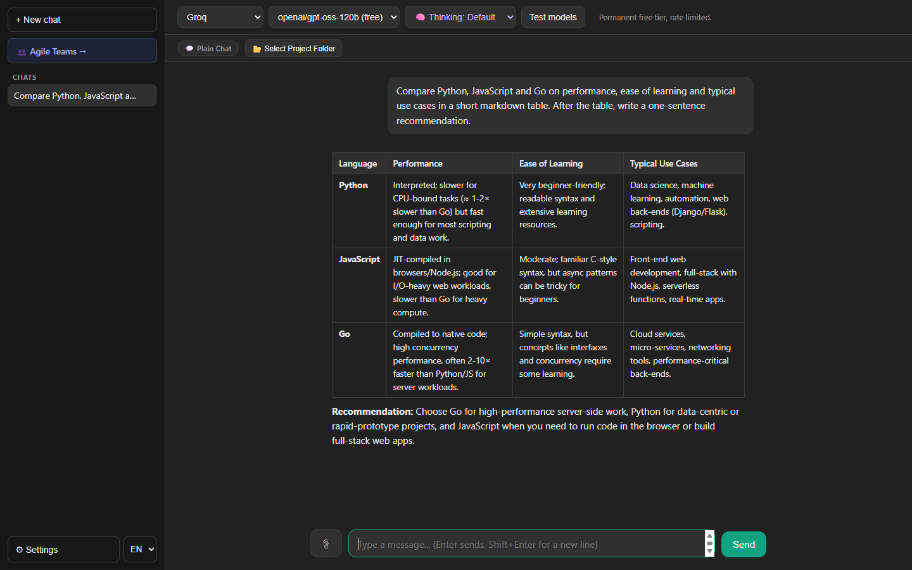
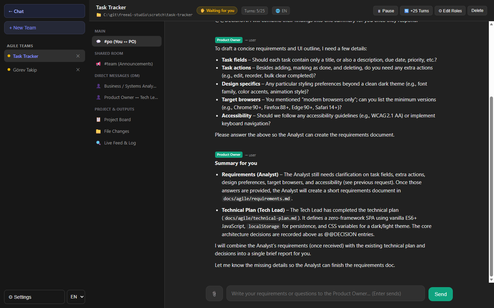
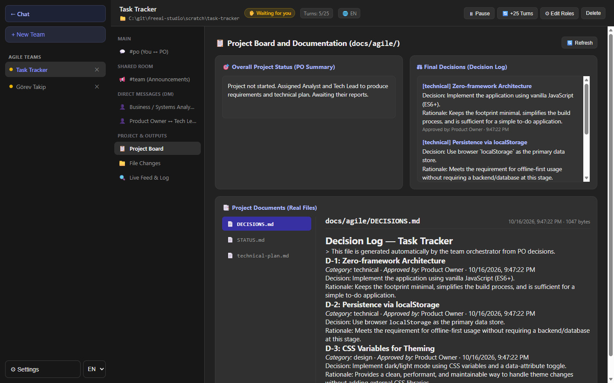
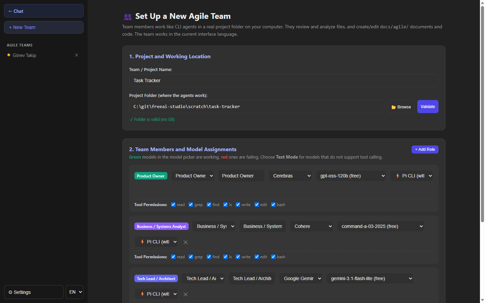

# FreeAI Studio

[Türkçe](README.md) · **English**

A local app for using AI providers with free tiers from a single interface. It has two main parts:

- **Chat:** chat with models from Groq, Cerebras, Google Gemini, Mistral, OpenRouter, NVIDIA NIM, Cohere, UnoRouter, Pollinations and AnyAPI. If you select a project folder, the chat turns into a coding assistant (Pi) that can read and edit your files.
- **Agile Team Room:** an AI team made up of Product Owner, Analyst, Tech Lead, Developer, UI/UX Designer and QA roles. The team plans and analyzes the task you give it by talking among themselves, and changes the project files when needed.

The interface is available in **English and Turkish**. Everything runs on your own computer; your keys and chats are not sent anywhere except to the provider you choose.



| Talking to the Product Owner | Project board and decision log |
| --- | --- |
|  |  |



## Requirements

- [Node.js](https://nodejs.org/) 22 or newer (the bundled Pi coding agent uses Node 22 APIs)
- An API key for at least one provider (available with a free account), or one of the subscriptions listed below

No npm packages are needed; there is no `npm install` step.

## Install and run

```bash
git clone https://github.com/muammeryilmaz/freeai-studio.git
cd freeai-studio
npm start
```

Then open in your browser:

- Chat: [http://127.0.0.1:3456/](http://127.0.0.1:3456/)
- Team Room: [http://127.0.0.1:3456/team.html](http://127.0.0.1:3456/team.html)

To change the port: `PORT=4000 npm start` (in Windows PowerShell: `$env:PORT=4000; npm start`).

## Language

Use the **TR / EN** selector in the bottom-left corner to switch the interface language; the choice is stored in the browser. On first launch, your browser's language is used.

- The server's error and info messages follow the selected language.
- The Pi coding assistant answers in the selected language.
- A team works in **the interface language that was active when it was created**: role prompts, internal team messages and the names of the documents under `docs/agile/` use that language. The 🌐 badge in the team header shows the team's language.

## Adding API keys

Enter and save a key for each provider in the Settings panel. Keys are written to `data/keys.json`. This file and the whole `data/` folder are excluded from git via `.gitignore`, so your keys never reach the repository. The folder and files are created automatically on first save.

### Signing in with a subscription (Pi)

Instead of an API key, you can also sign in with an existing subscription. The Pi section in Settings supports: OpenAI Codex / ChatGPT, Anthropic (Claude Pro/Max), GitHub Copilot, Kimi Code, Meta, xAI, OpenRouter (OAuth) and Radius. Credentials are written to `data/pi-agent/auth.json`.

## Project folder in chat

When you pick a folder with **📂 Select Project Folder** on the chat screen, messages go to the Pi coding assistant. It can read and edit files in that folder and run shell commands. If no folder is selected and you use a model connected through a Pi subscription, the assistant works in a temporary workspace under `data/pi-chat-scratch/`.

For models that support it, a thinking-level selector also appears in the top bar.

## Using the Team Room

1. In the Team Room, create a team with **+ New Team** and choose your project's folder in the "Project Folder" field.
2. Assign a provider and model to each role. Choose **Text Mode** for models that do not support tool calling; a role that hits a tool error in Pi mode switches to text mode automatically.
3. As the user, you only talk to the Product Owner. The other roles work on the tasks the PO hands out.
4. The team has a turn budget; when it runs out the team pauses, and you can continue with "+25 Turns".

> **Warning:** Team members can read, write and edit files in the selected project folder and run shell commands there. Back up important projects or use git before running a team on them.

### Loop protection

To stop roles from looping forever by sending each other "got it, noted" messages, the orchestrator enforces hard limits that do not depend on how the model behaves. All limits reset with every new user message:

| Protection | Limit |
| --- | --- |
| Turns for the PO (on its last turn it cannot assign tasks, only write the final report) | 10 |
| Total turns for every other role (new PO tasks cannot reset this counter) | 6 |
| Turns a role can spend on a single task | 4 |
| Wake-ups between two roles (beyond this the exchange is cut and the PO is warned) | 8 |
| Turn budget | 25 (extendable by +25) |

In addition, only task and question messages wake the recipient; info/acknowledgement messages never start a new turn, and repeated messages are dropped. As a result, one user message can produce at most `10 + 6 × (number of roles − 1)` turns.

### Free-tier tips

Team roles have long prompts, so free-tier tokens-per-minute limits can fill up quickly. For example, Groq's free tier limit of 8,000 tokens per minute may not be enough for even a single PO turn with `gpt-oss-120b`. Spreading roles across providers works best (e.g. PO → Cerebras, Analyst → Cohere, Tech Lead → Gemini, Developer → Groq). When a role hits a limit the team pauses; change its model with **Edit Roles** and click **Resume**.

## Security

- The server only listens on `127.0.0.1`.
- The API only accepts requests that come from the app's own pages: the `Host` and `Origin` headers are checked. This prevents other websites open in your browser from sending requests to the app (and therefore to agents that can run commands in your project folder).
- The file tools of text mode cannot access anything outside the project folder.

## Configuration and data

| Path | Contents | In git? |
| --- | --- | --- |
| `data/keys.json` | API keys | No |
| `data/pi-agent/` | Pi configuration and credentials | No |
| `data/pi-chats/`, `data/pi-chat-scratch/` | Pi chat sessions and temporary workspaces | No |
| `data/teams/` | Team conversations and session logs | No |
| Browser `localStorage` | Plain chat history, model and language selection | — |

| Environment variable | Description |
| --- | --- |
| `PORT` | Server port (default `3456`) |
| `FREEAI_DATA_DIR` | Data folder to use instead of `data/` |
| `FREEAI_LANG` | Language of the server's console messages (`tr` / `en`) |

## Tests

```bash
npm test
```

The tests do not call a real model. Using mock agents, they verify that the team stops even in worst-case scenarios, that text-mode tools work inside the project folder and cannot escape it, and that the Pi configuration is generated correctly.

## Project structure

```text
server.js         HTTP server, provider routing and chat API
team.js           Agile team orchestration, message routing and loop protection
team-prompts.js   Role prompts and internal team system texts (tr / en)
text-agent.js     Text-based agent (file read/write tools)
i18n.js           Server-side language support
pi-*.js           Pi coding agent integration (configuration, sign-in, thinking levels)
public/           UI files (chat, team room, i18n.js UI dictionary)
test/             Tests written with node:test
vendor/pi/        Bundled Pi coding agent (MIT licensed)
```

## License

[MIT](LICENSE). You are free to use, modify and distribute the code.

The Pi coding agent under `vendor/pi/` is also MIT licensed; see [vendor/pi/LICENSE](vendor/pi/LICENSE) for its copyright notice.
