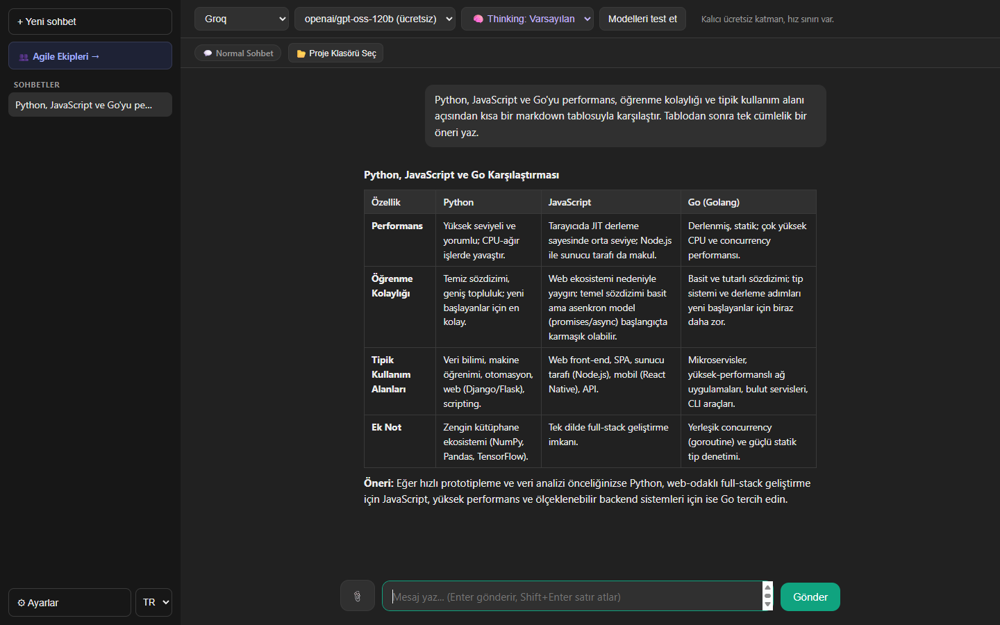
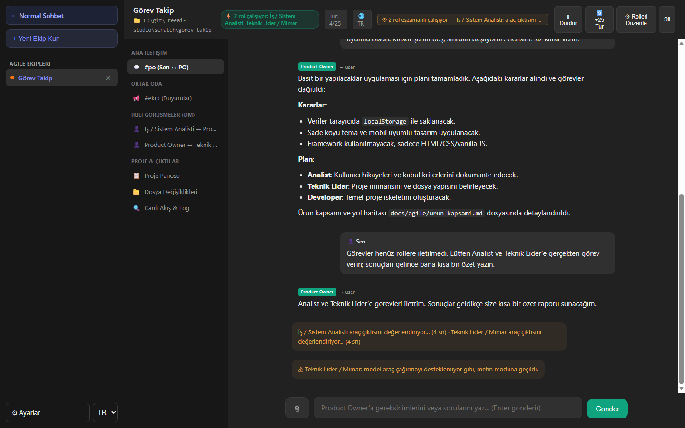
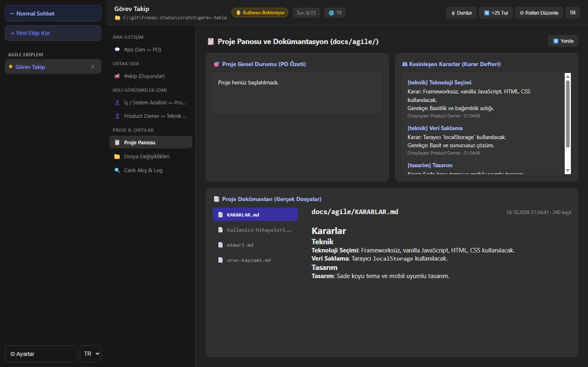
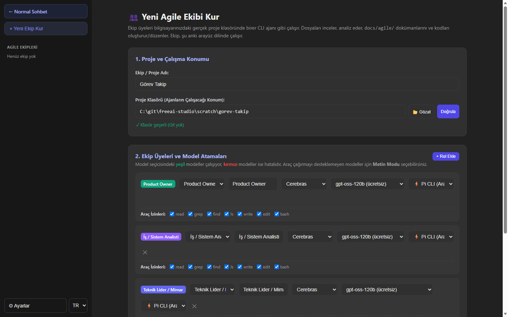

# FreeAI Studio

[English](README.md) · **Türkçe**

Ücretsiz katmanı olan yapay zeka sağlayıcılarını tek arayüzde kullanmak için yerel bir uygulama. İki ana parçası var:

- **Sohbet:** Groq, Cerebras, Google Gemini, Mistral, OpenRouter, NVIDIA NIM, Cohere, UnoRouter, Pollinations ve AnyAPI modelleriyle sohbet. Bir proje klasörü seçerseniz sohbet, dosyalarınızı okuyup düzenleyebilen bir kodlama asistanına (Pi) dönüşür.
- **Agile Ekip Odası:** Product Owner, Analist, Teknik Lider, Geliştirici, UI/UX Tasarımcı ve QA rollerinden oluşan yapay zeka ekibi. Ekip, verdiğiniz bir görevi kendi aralarında konuşarak planlar, analiz eder ve gerekirse proje dosyalarında değişiklik yapar.

Arayüz **İngilizce ve Türkçe** kullanılabilir. Uygulama tamamen kendi bilgisayarınızda çalışır; anahtarlarınız ve sohbetleriniz dışarı gönderilmez, yalnızca seçtiğiniz sağlayıcıya istek gider.



| Ekip çalışırken | Proje panosu ve karar defteri |
| --- | --- |
|  |  |



## Gereksinimler

- [Node.js](https://nodejs.org/) 22 veya üzeri (gömülü Pi kodlama asistanı Node 22'nin API'lerini kullanır)
- En az bir sağlayıcının API anahtarı (ücretsiz hesapla alınabilir) ya da aşağıda listelenen aboneliklerden biri

Harici bir npm paketi gerekmiyor; `npm install` adımı yoktur.

## Kurulum ve çalıştırma

```bash
git clone https://github.com/muammeryilmaz/freeai-studio.git
cd freeai-studio
npm start
```

Ardından tarayıcıda şu adresi açın:

- Sohbet: [http://127.0.0.1:3456/](http://127.0.0.1:3456/)
- Ekip Odası: [http://127.0.0.1:3456/team.html](http://127.0.0.1:3456/team.html)

Port değiştirmek için: `PORT=4000 npm start` (Windows PowerShell'de `$env:PORT=4000; npm start`).

## Dil

Arayüz varsayılan olarak **İngilizce** açılır. Sol alttaki **EN / TR** seçicisinden Türkçeye geçebilirsiniz; seçim tarayıcıda saklanır.

- Sunucunun hata ve bilgi mesajları da seçili dilde gelir.
- Pi kodlama asistanı seçili dilde yanıt verir.
- Bir ekip, **kurulduğu andaki arayüz dilinde** çalışır: rol istemleri, ekip içi yazışmalar ve `docs/agile/` altındaki dokümanların adları o dildedir. Ekip başlığındaki 🌐 rozeti ekibin dilini gösterir.

## API anahtarlarını ekleme

Arayüzün Ayarlar bölümünden her sağlayıcı için anahtarınızı girip kaydedin. Anahtarlar `data/keys.json` dosyasına yazılır. Bu dosya ve `data/` klasörünün tamamı `.gitignore` ile git dışında tutulur; anahtarlarınız repoya gitmez. Klasör ve dosyalar ilk kayıtta otomatik oluşturulur.

### Abonelikle giriş (Pi)

API anahtarı yerine mevcut bir aboneliğinizle de giriş yapabilirsiniz. Ayarlar'daki Pi giriş bölümü şu sağlayıcıları destekler: OpenAI Codex / ChatGPT, Anthropic (Claude Pro/Max), GitHub Copilot, Kimi Code, Meta, xAI, OpenRouter (OAuth) ve Radius. Giriş bilgileri `data/pi-agent/auth.json` dosyasına yazılır.

## Sohbette proje klasörü

Sohbet ekranındaki **📂 Proje Klasörü Seç** ile bir klasör seçtiğinizde mesajlar Pi kodlama asistanına gider. Asistan bu klasördeki dosyaları okuyabilir, düzenleyebilir ve kabukta komut çalıştırabilir. Klasör seçili değilse ve Pi aboneliğiyle bağlı bir model kullanıyorsanız asistan `data/pi-chat-scratch/` altındaki geçici bir çalışma alanında çalışır.

Destekleyen modellerde üst çubukta bir düşünme (thinking) seviyesi seçicisi de görünür.

## Ekip Odası kullanımı

1. Ekip Odası'nda **+ Yeni Ekip Kur** ile ekip oluşturun ve "Proje Klasörü" alanından projenizin klasörünü seçin.
2. Her role bir sağlayıcı ve model atayın. Araç çağırmayı desteklemeyen modeller için **Metin Modu**'nu seçin; Pi modunda araç hatası alan bir rol otomatik olarak metin moduna geçer.
3. Kullanıcı olarak yalnızca Product Owner ile konuşursunuz. Diğer roller, PO'nun dağıttığı görevler üzerinden çalışır.
4. Ekibin bir tur bütçesi vardır; bütçe dolunca duraklar ve "+25 Tur" ile devam ettirebilirsiniz.

> **Dikkat:** Ekip üyeleri seçtiğiniz proje klasöründeki dosyaları okuyabilir, yazabilir, düzenleyebilir ve kabukta komut çalıştırabilir. Önemli bir projede çalıştırmadan önce yedek alın ya da git ile çalışın.

### Döngü koruması

Roller birbirine "anladım, not ettim" yazarak sonsuz bir döngüye girmesin diye orkestratör, modelin davranışından bağımsız kesin sınırlar uygular. Bütün sınırlar kullanıcının her yeni mesajında sıfırlanır:

| Koruma | Sınır |
| --- | --- |
| PO'nun tur sayısı (son turunda görev dağıtamaz, yalnızca nihai rapor yazar) | 10 |
| PO dışındaki her rolün toplam tur sayısı (PO'nun yeni görevleri bu sayacı sıfırlayamaz) | 6 |
| Bir rolün tek bir görevdeki tur sayısı | 4 |
| İki rol arasındaki uyandırma sayısı (aşılırsa yazışma kesilir ve PO uyarılır) | 8 |
| Tur bütçesi | 25 (+25 ile uzatılabilir) |

Ayrıca yalnızca görev ve soru mesajları karşı tarafı uyandırır; bilgi/onay mesajları yeni bir tur başlatmaz, aynı mesajın tekrarı da engellenir. Böylece bir kullanıcı mesajı en fazla `10 + 6 × (rol sayısı − 1)` tur üretebilir.

### Ücretsiz katman ipuçları

Ekip rollerinin istemleri uzun olduğu için ücretsiz katmanların dakikalık token sınırları çabuk dolabilir. Örneğin Groq'un ücretsiz katmanındaki dakikada 8.000 token sınırı, `gpt-oss-120b` ile tek bir PO turuna bile yetmeyebilir. Rolleri farklı sağlayıcılara dağıtmak (ör. PO → Cerebras, Analist → Cohere, Teknik Lider → Gemini, Geliştirici → Groq) en iyi sonucu verir. Bir rol sınıra takıldığında ekip duraklar; **Rolleri Düzenle** ile modeli değiştirip **Devam** diyebilirsiniz.

## Güvenlik

- Sunucu yalnızca `127.0.0.1` adresini dinler.
- API yalnızca bu makinedeki arayüzden gelen istekleri kabul eder: `Host` ve `Origin` başlıkları denetlenir. Böylece tarayıcınızda açık başka bir web sitesi, uygulamaya (ve dolayısıyla proje klasöründe komut çalıştırabilen ajanlara) istek gönderemez.
- Metin modundaki dosya araçları proje klasörünün dışına erişemez.

## Yapılandırma ve veri

| Yol | İçerik | Git'e dahil mi? |
| --- | --- | --- |
| `data/keys.json` | API anahtarları | Hayır |
| `data/pi-agent/` | Pi yapılandırması ve giriş bilgileri | Hayır |
| `data/pi-chats/`, `data/pi-chat-scratch/` | Pi sohbet oturumları ve geçici çalışma alanları | Hayır |
| `data/teams/` | Ekip sohbetleri ve oturum kayıtları | Hayır |
| Tarayıcı `localStorage` | Normal sohbet geçmişi, model ve dil seçimi | — |

| Ortam değişkeni | Açıklama |
| --- | --- |
| `PORT` | Sunucu portu (varsayılan `3456`) |
| `FREEAI_DATA_DIR` | `data/` yerine kullanılacak veri klasörü |
| `FREEAI_LANG` | Sunucunun konsol mesajlarının dili (`tr` / `en`) |

## Testler

```bash
npm test
```

Testler gerçek bir modele bağlanmaz. Sahte ajanlarla ekibin en kötü senaryolarda da durduğunu, metin modu araçlarının proje klasöründe çalışıp dışına çıkamadığını ve Pi yapılandırmasını doğrular.

## Proje yapısı

```text
server.js         HTTP sunucusu, sağlayıcı yönlendirmesi ve sohbet API'si
team.js           Agile ekip orkestrasyonu, mesaj yönlendirme ve döngü korumaları
team-prompts.js   Rol istemleri ve ekip içi sistem metinleri (tr / en)
text-agent.js     Metin tabanlı ajan (dosya okuma/yazma araçları)
i18n.js           Sunucu tarafı dil desteği
pi-*.js           Pi kodlama asistanı entegrasyonu (yapılandırma, giriş, düşünme modu)
public/           Arayüz dosyaları (sohbet, ekip odası, i18n.js arayüz sözlüğü)
test/             node:test ile yazılmış testler
vendor/pi/        Gömülü Pi kodlama asistanı (MIT lisanslı)
```

## Lisans

[MIT](LICENSE). Kodu istediğiniz gibi kullanabilir, değiştirebilir ve dağıtabilirsiniz.

`vendor/pi/` altındaki Pi kodlama asistanı da MIT lisanslıdır; telif bilgisi için [vendor/pi/LICENSE](vendor/pi/LICENSE) dosyasına bakın.
